<!-- header:start -->
<div align="center">



<a href="#-quick-start"></a>

<a href="LICENSE"></a>

<a href="https://github.com/ajendras/sentinel-ai/stargazers"></a>
<a href="https://github.com/ajendras/sentinel-ai/actions/workflows/ci.yml"></a>

<a href="CONTRIBUTING.md"></a>

**Autonomous PHP agents that combine Apktool decompilation with LLM reasoning to audit Android and web app security**

[✨ Features](#-features) • [⚡ Quick start](#-quick-start) • [🧰 Usage](#-usage) • [🧩 Architecture](#-architecture) • [📍 Roadmap](#-roadmap) • [🤝 Contributing](#-contributing)

</div>
<!-- header:end -->

## ✨ Why Sentinel AI?

Security audits remain manual, slow, and require niche expertise in reverse engineering and prompt engineering. Apktool produces rich artifacts that still need deep interpretation, while truly autonomous agent loops have lived mostly in Python. Sentinel AI delivers a native PHP framework that wraps Apktool, lets a `CoreAgent` reason over decompiled code and web endpoints with LLMs, and outputs developer-friendly findings with severity, evidence and remediation steps.

- **Autonomous ReAct loops** — `CoreAgent::plan()`, `selectTool()` and `executeLoop()` iterate without human guidance until a final `Report` is synthesized.
- **Zero Python** — full PHP 8.3 implementation using Symfony Console, Guzzle and the official OpenAI PHP client.
- **Android + web coverage** — `ApkDecompiler`, `AndroidManifestAnalyzer` and `WebVulnScanner` plus LLM triage for OWASP Mobile and Web Top 10 issues.
- **Actionable output** — console tables, JSON and self-contained Tailwind HTML reports generated by `ReportGenerator`.

Perfect for PHP backend teams, mobile security engineers and DevSecOps pipelines that want LLM-augmented audits inside their existing PHP toolchain.

## 🎬 Demo

<p align="center"></p>

## 🚀 Features

<table>
<tr>
<td valign="top">
🔄 <b>Autonomous Agents</b><br>
CoreAgent plans, selects tools, evaluates results and iterates without human guidance
</td>
<td valign="top">
📦 <b>Apktool Wrapper</b><br>
Decompiles APKs, extracts manifest, resources and Smali with one method call
</td>
<td valign="top">
🧠 <b>Security Analyzer</b><br>
LLM examines decompiled code, permissions, web responses for OWASP issues
</td>
</tr>
<tr>
<td valign="top">
🌐 <b>Web Scanner</b><br>
Crawls PHP apps and detects XSS, SQLi, insecure headers and misconfigurations
</td>
<td valign="top">
📊 <b>Rich Reports</b><br>
Generates console, JSON and self-contained HTML reports with severity and fixes
</td>
<td valign="top">
🔌 <b>Tool Registry</b><br>
Extensible registry lets you register new PHP tools in seconds
</td>
</tr>
<tr>
<td valign="top">
💬 <b>Interactive Mode</b><br>
Chat with the agent to drill into specific findings or request deeper analysis
</td>
<td valign="top">
⚙️ <b>Configurable LLMs</b><br>
Works with OpenAI, Azure or any OpenAI-compatible endpoint via simple config
</td>
</tr>
</table>

## 📦 Installation

**Requirements**

- PHP 8.3+
- Composer
- Apktool (for Android audits)
- OpenAI API key (or compatible endpoint)

```bash
composer require sentinel-ai/sentinel-ai
```

After installation the CLI is available at `vendor/bin/sentinel`.

Initialize a configuration file:

```bash
vendor/bin/sentinel init
```

## ⚡ Quick start

```bash
# Run a complete Android audit (after setting your API key)
vendor/bin/sentinel audit \
  --target=app.apk \
  --type=android \
  --output=./reports
```

This command:
- boots `Application` and `AgentFactory`
- creates a `SecurityAgent`
- calls `SecurityAgent::audit($target, 'android')`
- runs the autonomous `CoreAgent::executeLoop()`
- writes JSON + HTML reports via `ReportGenerator`

## 🧰 Usage

### Android APK audit

```bash
vendor/bin/sentinel audit --target=release.apk --type=android
```

`SecurityAgent` automatically decompiles with `ApkDecompiler::decompile()`, runs `AndroidManifestAnalyzer::analyze()` for exported components and dangerous permissions, then lets the LLM evaluate Smali patterns.

### Web application scan

```bash
vendor/bin/sentinel audit --target=https://example.com --type=web
```

`WebVulnScanner::scan()` crawls the site while `checkXSS()`, `checkHeaders()` and `checkSQLInjection()` feed observations into the `SecurityAnalyzer`.

### Interactive exploration

```bash
vendor/bin/sentinel audit --target=app.apk --type=android --interactive
```

After the audit finishes, `AuditCommand::runInteractiveMode()` lets you browse each `Report` with full evidence and remediation using SymfonyStyle prompts.

<details><summary>Programmatic usage</summary>

```php
use Sentinel\Application;
use Sentinel\Agent\SecurityAgent;

$app = new Application();
$agent = $app->getConfig()->createSecurityAgent(); // via factory internally

$reports = $agent->audit('/path/to/app.apk', 'android');

foreach ($reports as $report) {
    echo $report->getSeverity() . ': ' . $report->getTitle() . "\n";
}
```
</details>

<details><summary>Custom tool registration</summary>

```php
use Sentinel\Tools\ToolRegistry;

$registry = new ToolRegistry();
$registry->register('custom-scanner', new MyCustomTool());

$agent = new SecurityAgent($llm, $registry, $config);
$reports = $agent->audit($target, $type);
```
</details>

## 🔧 Configuration

Sentinel loads `sentinel.json` (created by `InitCommand`). All values are accessible via `Config::getLLMConfig()`, `getToolConfig()` and `getSecurityConfig()`.

| Option                        | Default               | Description |
|-------------------------------|-----------------------|-------------|
| `llm.model`                   | `gpt-4o-mini`         | Model passed to `OpenAIClient` for all `complete()` calls |
| `llm.api_key`                 | `env(OPENAI_API_KEY)` | Key used by `OpenAIClient`; falls back to environment variable |
| `tool.max_steps`              | `12`                  | Maximum iterations passed to `CoreAgent::executeLoop()` |
| `security.confidence_threshold` | `65`                | Minimum confidence for `Report` objects surfaced by `SecurityAnalyzer` |
| `report.output_dir`           | `./sentinel-reports`  | Directory used by `AuditCommand` and `ReportGenerator::saveJson()` / `saveHtml()` |

## 🧩 Architecture

```mermaid
flowchart TD
    CLI[bin/sentinel] --> AuditCommand
    AuditCommand --> AgentFactory
    AgentFactory --> SecurityAgent
    SecurityAgent --> CoreAgent
    CoreAgent --> ToolRegistry
    CoreAgent --> LLM[OpenAIClient]
    CoreAgent --> SecurityPrompts
    ToolRegistry --> ApkDecompiler
    ToolRegistry --> WebVulnScanner
    SecurityAgent --> AndroidManifestAnalyzer
    SecurityAgent --> SecurityAnalyzer
    SecurityAnalyzer --> LLM
    CoreAgent --> Report[Report[]]
    Report --> ReportGenerator
    ReportGenerator --> Console
    ReportGenerator --> JSON
    ReportGenerator --> HTML[Tailwind HTML]
```

`CoreAgent` implements a classic ReAct loop (`plan()`, `selectTool()`, `evaluate()`, `synthesizeFinalReport()`) that queries the `LLMInterface` at every decision point. `SecurityAgent` pre-loads security-specific tools and calls `AndroidManifestAnalyzer` and `SecurityAnalyzer` for hybrid static+LLM findings. All outputs are normalized through immutable `Report` value objects; `ReportGenerator` produces the final console, JSON and HTML artifacts.

## 📁 Project structure

```text
.
├── bin/
│   └── sentinel                    # Shebang entrypoint; instantiates Application
├── src/
│   ├── Application.php             # Bootstraps container, ToolRegistry, LLM and commands
│   ├── Config.php                  # Loads sentinel.json; getLLMConfig(), getToolConfig()
│   ├── Agent/
│   │   ├── CoreAgent.php           # plan(), selectTool(), executeLoop(), evaluate()
│   │   ├── SecurityAgent.php       # audit(), buildSecurityObjective(), preloadSecurityTools()
│   │   └── AgentFactory.php        # create('android'|'web')
│   ├── Analyzers/
│   │   ├── AndroidManifestAnalyzer.php  # analyze() → Report[] for permissions, exported components
│   │   └── SecurityAnalyzer.php    # analyze() uses LLM + parseLlmResponse()
│   ├── Commands/
│   │   ├── AuditCommand.php        # --target, --type, --interactive, --model, --output
│   │   └── InitCommand.php         # Creates default sentinel.json
│   ├── LLM/
│   │   ├── LLMInterface.php        # complete(Prompt), stream()
│   │   └── OpenAIClient.php        # Implements LLMInterface with OpenAI PHP client
│   ├── Prompts/
│   │   └── SecurityPrompts.php     # forPlanning(), forToolSelection(), forApkAnalysis()...
│   ├── Reporters/
│   │   ├── Report.php              # Immutable VO: id, severity, title, evidence, remediation
│   │   └── ReportGenerator.php     # generateConsole(), saveJson(), saveHtml()
│   ├── Tools/
│   │   ├── ToolRegistry.php        # register(), get(), listAll(), has()
│   │   ├── ApkDecompiler.php       # decompile(), getManifest(), extractSmaliClasses()
│   │   └── WebVulnScanner.php      # scan(), checkXSS(), checkHeaders(), checkSQLInjection()
│   └── Exceptions/
│       └── AgentException.php      # CONFIG_ERROR, LLM_ERROR, TOOL_ERROR, REASONING_ERROR
├── tests/Unit/
│   ├── CoreAgentTest.php           # Tests planning loop, tool selection, evaluation
│   └── ApkDecompilerTest.php       # Mocks apktool and manifest parsing
├── composer.json
└── sentinel.json                   # Generated by init command
```

## 🧪 Testing

```bash
composer test
# or
vendor/bin/phpunit
```

The suite covers `CoreAgent` planning and reasoning loop logic, `selectTool()` fallback behaviour, `AndroidManifestAnalyzer` permission and component checks, and mocked `ApkDecompiler` shell execution via `ApkDecompilerTest`.

## 📍 Roadmap
<!-- roadmap:start -->
- [x] **v0.1.0** — first release: Autonomous Agents, Apktool Wrapper, Security Analyzer, Web Scanner
- [ ] Add Ollama / local LLM support in OpenAIClient
- [ ] Implement HTML report interactive explorer with search and filters
- [ ] Create plugin system allowing composer packages to register new Tools
- [ ] Add dynamic analysis via integrated OWASP ZAP wrapper
- [ ] Support JavaScript deobfuscation for hybrid Cordova apps
- [ ] Generate suggested code patches for identified issues
- [ ] Build GitHub Action that runs sentinel on PRs and comments findings
- [ ] Match discovered libraries against known CVE database
- [ ] Add support for iOS IPA unpacking via ipsw tool wrapper
- [ ] Create web dashboard (public/index.php) for managing audit history
- [ ] Implement agent memory using SQLite to avoid repeating analysis
- [ ] Add automated APK rebuild after applying AI-suggested manifest fixes

> 🤖 This roadmap is worked through continuously — ideas and PRs welcome!
<!-- roadmap:end -->

## 🤝 Contributing

Contributions are welcome and appreciated! Whether it's a new tool, improved prompt, bug fix or documentation tweak, please read our [CONTRIBUTING.md](https://github.com/sentinel-ai/sentinel-ai/blob/main/CONTRIBUTING.md) and follow the [CODE_OF_CONDUCT.md](https://github.com/sentinel-ai/sentinel-ai/blob/main/CODE_OF_CONDUCT.md).

We maintain a list of **good first issues** — perfect for first-time contributors to the project. Open a PR against the `main` branch and we'll review it promptly.

## 📄 License

This project is licensed under the MIT License — see the [LICENSE](LICENSE) file for details.

<!-- footer:start -->
<div align="center">

### ⭐ Star history

<a href="https://star-history.com/#ajendras/sentinel-ai&Date"></a>

If **Sentinel AI** saves you time, a ⭐ helps others find it.

Made with ❤️ by [Ajendra](https://ajendra.info)


</div>
<!-- footer:end -->
